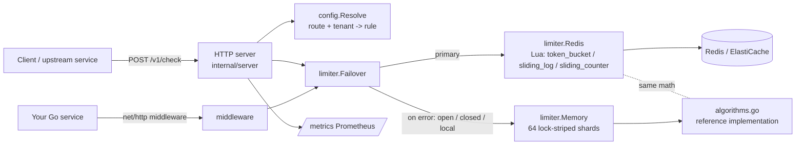

# edge-limiter

A distributed rate-limiting service and embeddable Go library. It implements three algorithms
(a GCRA token bucket, a sliding-window log and a sliding-window counter) over two interchangeable
backends: a sharded in-memory store and Redis, where every decision is one atomic Lua script. The
technically interesting part is that the Go implementation and the Lua scripts do the same IEEE-754
operations in the same order on integer microseconds. A test replays random traffic through both and
requires the decisions to match exactly, which makes "the Redis path behaves like the tested Go path"
something the tests check, not something you have to assume. The service also has an explicit policy
for Redis outages (fail-open, fail-closed, or a per-replica local limiter, behind a circuit breaker), and
ships with Prometheus metrics, Kubernetes manifests and an AWS Terraform module.

## Features

- **Algorithms:** token bucket (GCRA, with configurable burst), sliding-window log (exact), and
  sliding-window counter (O(1) memory, approximate).
- **Backends:** an in-memory store with 64 lock-striped shards (`hash/maphash`) and a janitor that evicts
  expired keys; Redis through go-redis with `EVALSHA` Lua scripts. The Redis tests use
  [miniredis](https://github.com/alicebob/miniredis), so no server is needed.
- **Failure policy:** `limiter.Failover` wraps Redis. You pick `open`, `closed` or `local` (an in-memory
  fallback limiter). After a failure it skips Redis for a cooldown period, so an outage does not add a
  timeout to every request.
- **HTTP API:** `POST /v1/check {key, cost, route?, tenant?}` returns `allowed, remaining, reset_at,
  retry_after`. There are also `GET /healthz` (liveness), `GET /readyz` (readiness, aware of shutdown and
  the failure mode) and `GET /metrics`.
- **Go middleware** for `net/http` (`middleware.New`). It sets the IETF-draft `RateLimit-*` headers and
  `Retry-After`, returns 429 with a JSON body, and lets you plug in your own key, cost and policy
  functions.
- **YAML config:** per-route and per-tenant rules (first match wins), a default limit, burst, backend
  choice, failure mode and cooldown. You can override settings with `EDGE_LIMITER_*` environment
  variables. Unknown keys are rejected.
- **Observability:** Prometheus counters for HTTP requests and for decisions (by rule and result), a
  backend latency histogram, a fallback counter, structured JSON logs (`log/slog`), and graceful shutdown
  (readiness drops first, then in-flight requests drain).
- **Deployment:** a distroless multi-stage Dockerfile, docker-compose with Redis, Kubernetes manifests
  (Deployment, Service, HPA, PodDisruptionBudget, ConfigMap, kustomization), and a Terraform module for
  AWS (ECS Fargate + ElastiCache Redis + ALB, with autoscaling).

## Architecture



- **One reference implementation, mirrored in Lua.** `limiter/algorithms.go` holds pure state-transition
  functions. The memory backend calls them directly, and `limiter/lua/*.lua` mirror them line for line.
  Time is integer microseconds because Lua numbers are doubles: Unix nanoseconds would lose precision,
  but microseconds (~1.8e15) fit exactly. `TestBackendsAgree` replays 2,000 random requests per
  algorithm and fails on any difference. Changing one `ceil` to `floor` in a script makes it fail on the
  first request.
- **The token bucket uses GCRA.** It stores a single "theoretical arrival time" per key instead of a
  token count and a timestamp, so the Redis state is one string and the update is a single `SET … PX`.
- **The sliding-window log stores one sorted-set member per unit of cost.** That makes `retry_after`
  exact (a `ZRANGE` at index `need-1`) at the cost of O(limit) memory per key. The counter variant is
  the O(1) alternative, and the accuracy benchmark shows what that saves you and what it costs.
- **Time comes from the replica's clock, passed into the script.** This keeps the scripts deterministic
  and testable with a fake clock, but it means replicas need NTP-synchronised clocks (see Limitations).
- **Failure handling is a policy, not an accident.** A cancelled request context does not trip the
  breaker. In `closed` mode, `/readyz` returns 503 while Redis is unreachable, so the orchestrator stops
  routing to a replica that could only deny. In `open` and `local` modes it reports `degraded` and stays
  in rotation.

## Quickstart

Requires Go 1.27.

```bash
go test ./...                                   # unit, concurrency, middleware and failover tests
go run ./cmd/edge-limiter -config configs/local.yaml   # in-memory backend on :8080
```

In another shell (output copied from a local run on 2026-11-06). The `login` rule in
`configs/local.yaml` allows 5 requests per minute with the sliding-window log:

```bash
$ for i in 1 2 3 4 5 6; do curl -s -X POST localhost:8080/v1/check -d '{"key":"alice","route":"/v1/login"}'; done
{"allowed":true,"rule":"login","limit":5,"remaining":4,"reset_at":"2026-11-06T14:54:33.936035Z","retry_after":0}
{"allowed":true,"rule":"login","limit":5,"remaining":3,"reset_at":"2026-11-06T14:54:34.255611Z","retry_after":0}
{"allowed":true,"rule":"login","limit":5,"remaining":2,"reset_at":"2026-11-06T14:54:34.304953Z","retry_after":0}
{"allowed":true,"rule":"login","limit":5,"remaining":1,"reset_at":"2026-11-06T14:54:34.348551Z","retry_after":0}
{"allowed":true,"rule":"login","limit":5,"remaining":0,"reset_at":"2026-11-06T14:54:34.387368Z","retry_after":0}
{"allowed":false,"rule":"login","limit":5,"remaining":0,"reset_at":"2026-11-06T14:54:34.387368Z","retry_after":59.520318}

$ curl -s localhost:8080/metrics | grep ^edge_limiter_checks
edge_limiter_checks_total{result="allowed",rule="login"} 5
edge_limiter_checks_total{result="denied",rule="login"} 1
```

With Redis (not run on the development machine, which has no Docker):

```bash
docker compose up --build        # Redis + edge-limiter using configs/compose.yaml
```

Embedding the middleware:

```go
limit := limiter.Limit{Algorithm: limiter.TokenBucket, Rate: 5, Period: time.Second, Burst: 10}
mw := middleware.New(middleware.Options{
    Backend: limiter.NewMemory(),          // or a *limiter.Failover around limiter.NewRedis(...)
    Policy:  middleware.StaticPolicy("api", limit),
    Key:     middleware.HeaderKey("X-Tenant-ID"),
})
http.ListenAndServe(":8080", mw(mux))
```

### Configuration

See `configs/compose.yaml` for every option. Rules are matched in order: `route` is a path prefix and
`tenant` an exact match, and an empty value matches anything. The Redis password is read only from
`EDGE_LIMITER_REDIS_PASSWORD`. Other overrides are listed in `.env.example`.

## Results

All numbers come from `go run ./bench/cmd/report -cpu "12th Gen Intel(R) Core(TM) i7-12700"`, which wrote
[`bench/RESULTS.md`](bench/RESULTS.md). They were measured on 2026-11-06 on an Intel Core i7-12700
(16 logical CPUs) running Windows 11 Pro with Go 1.27.3. It is a desktop, and other applications were
running, so treat throughput as indicative. The micro-benchmarks and HTTP runs are each the median of 3.
The traffic is **synthetic** and generated from a fixed seed in `bench/bench.go`.

**Accuracy under bursty traffic.** One key, limit 100 per second (token bucket burst = 100), 60 simulated
seconds. The traffic is a Poisson background at 60 req/s plus bursts of 400 requests within 200 ms,
arriving every ~3 s on average: 11,589 requests, or 193 req/s offered. This runs on a manual clock, so it
is deterministic.

| algorithm | allowed | mean allowed/s | max admitted in any 1 s window | vs limit | memory == miniredis |
|---|---:|---:|---:|---:|---|
| token_bucket | 5083 | 84.7 | 198 | +98% | true |
| sliding_window_log | 4148 | 69.1 | 100 | +0% | true |
| sliding_window_counter | 4241 | 70.7 | 138 | +38% | true |

What the table shows:
- **The sliding-window log never exceeds the limit in any trailing window.**
- **The token bucket admits up to burst plus one period of refill** (198 here, against a theoretical
  ceiling of 200). That is by design: burst is the knob that lets a full bucket be spent at once.
- **The counter's "previous window is uniform" assumption breaks under bursts.** It let 138 requests
  through in the worst window, while using O(1) state instead of O(limit).
- **Both backends made identical decisions** in all three cases.

**HTTP load test.** `bench/load` sends `POST /v1/check` to an in-process server over loopback TCP, with
64 workers, 5 s per run and 10,000 random keys, using the default rule. The load generator runs on the
same machine.

| backend | checks/sec | p50 | p95 | p99 | max | errors |
|---|---:|---:|---:|---:|---:|---:|
| memory | 68,513 | 0.57 ms | 3.44 ms | 6.11 ms | 26.65 ms | 0 |
| miniredis | 7,945 | 8.22 ms | 10.64 ms | 12.46 ms | 22.48 ms | 0 |

**Backend micro-benchmarks.** `Allow` is called from 16 goroutines over 1,024 keys. After the first
second most calls take the deny path, which costs the same as the allow path. You can reproduce these
with `go test -run '^$' -bench . ./bench`.

| backend | algorithm | ns/op | checks/sec | allocs/op |
|---|---|---:|---:|---:|
| memory | token_bucket | 27 | 37,483,324 | 0 |
| memory | sliding_window_log | 24 | 41,731,456 | 0 |
| memory | sliding_window_counter | 24 | 41,061,430 | 0 |
| miniredis | token_bucket | 164,859 | 6,066 | 827 |
| miniredis | sliding_window_log | 202,048 | 4,949 | 852 |
| miniredis | sliding_window_counter | 210,331 | 4,754 | 868 |

**The miniredis rows are not Redis performance.** miniredis is a single-process Go emulator that builds a
new Lua VM for every script call. These rows show that the real scripts and the go-redis client path
work end to end. Measuring against a real Redis or ElastiCache is a next step and has not been done.

## Tests and CI

```bash
go vet ./...
go test ./...              # 32 top-level tests (+12 subtests), all passing locally
go test -race ./...        # runs in CI; -race needs cgo, which this Windows machine lacks
```

The tests cover:
- each algorithm on a fake clock, with exact `remaining`, `reset_at` and `retry_after`;
- memory-vs-Redis equivalence;
- concurrency: 32 goroutines (memory) or 8 (miniredis) hit one key and exactly `limit` requests may be admitted
  (no over-admission);
- the three failure modes against a stopped miniredis, the circuit-breaker cooldown and recovery, and
  that a cancelled context does not trip the breaker;
- middleware headers, keys, cost and error handling;
- HTTP validation, readiness per failure mode, and the metrics output;
- graceful shutdown of the real `run()` loop;
- the accuracy bounds;
- that every shipped config and the Kubernetes ConfigMap parse, and that the manifests are well formed.

Local statement coverage: `limiter` 87%, `middleware` 93%, `internal/server` 92%, `internal/config` 94%.

`.github/workflows/ci.yml` has three jobs:
- **go:** gofmt check, `go vet`, `go test -race`, `go build`, and one pass of the benchmarks.
- **terraform:** `hashicorp/setup-terraform`, `terraform fmt -check -recursive`, and
  `terraform init -backend=false && terraform validate` on `deploy/terraform/examples/basic`, which
  instantiates the module.
- **docker:** `docker build` with Buildx, then a smoke test of the image (`/healthz` and `/v1/check`).

### What was and was not executed locally

The development machine (Windows 11) has no Docker, terraform, kubectl or C toolchain.

- **Executed:** `go build`, `go vet`, `go test` (without `-race`), the benchmark report, and the
  service binary queried with curl (the Quickstart output above).
- **Checked without the real tools:**
  - The Terraform files were parsed and format-checked with `hclwrite.Format` from `hashicorp/hcl/v2`,
    the library `terraform fmt` uses, through a throwaway script that is not in the repo.
  - The Kubernetes manifests and the ConfigMap's embedded config are parsed by `internal/config` tests.
- **Not executed:**
  - `docker build` and `docker compose up`;
  - `terraform init`, `validate`, `plan` and `apply`;
  - `kubectl apply` or a dry run;
  - `go test -race`;
  - anything against a real Redis or ElastiCache.

  CI is set up to run the first four. Nothing has been deployed to AWS or a Kubernetes cluster.

## Limitations and next steps

- **Clock skew.** Replicas pass their own time to Redis. Skew between replicas shifts windows by the
  skew amount. Using Redis `TIME` inside the scripts would remove that, at the cost of fake-clock
  testability.
- **Local fallback is per replica.** In `local` mode with N replicas, the effective limit during an
  outage is up to N times the configured one, until Redis returns.
- **Single-key scripts only.** Each key maps to one Redis key, so the scripts are Redis Cluster-safe,
  but cluster mode and the go-redis `ClusterClient` have not been tested.
- **Sliding-window log memory is O(limit) per key**, so it is best kept for small limits such as login
  or OTP. Costs larger than a rule's capacity are rejected with 400.
- **Fixed placeholders.** The module path `github.com/HappyVirgo/edge-limiter` and the image name
  `ghcr.io/happyvirgo/edge-limiter` are placeholders. The Terraform example needs your own VPC and subnet
  IDs (`terraform.tfvars.example`).
- **Next steps:**
  - benchmark against real Redis and ElastiCache;
  - hot-reload the config on ConfigMap change;
  - a gRPC API;
  - Redis Cluster tests;
  - a published Helm chart.
